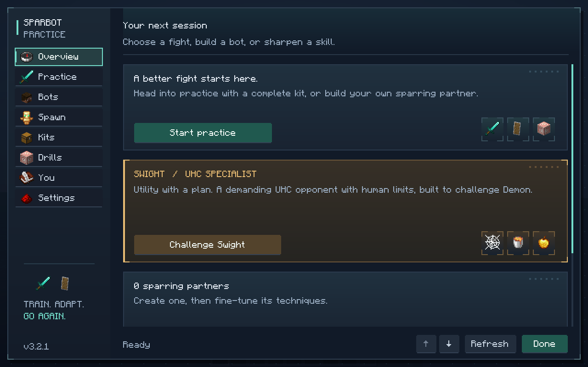
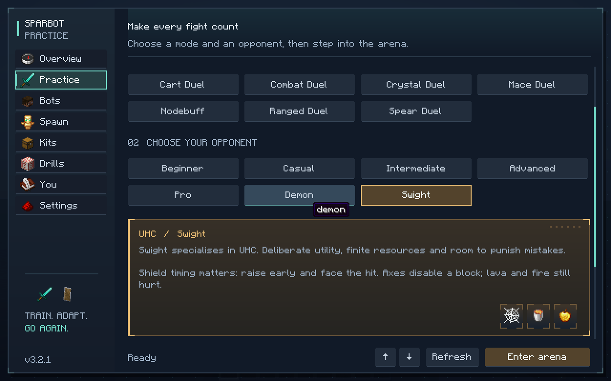

# SparBot 3.2.1

[Download sparbot-3.2.1.jar](https://github.com/flick256/minecraft-pvp-mod-that-is-super-cool/raw/refs/heads/builds/sparbot-3.2.1/sparbot-3.2.1.jar)

For Minecraft Java 26.2, Java 25 and Fabric Loader 0.19.3 or newer. Install Fabric API
0.161.0+26.2 or newer alongside this jar. Replace the older SparBot jar in your mods folder.

This update corrects shield follow-up timing and spacing, improves Swight's handling of obstructing
webs, and adds native item illustrations, icons, gradients and corner details to the menu.
Normal shield blocking, human input limits and finite kits still apply.

[Source changes](https://github.com/flick256/minecraft-pvp-mod-that-is-super-cool/tree/codex/swight-shield-polish)

See SHA256SUMS to verify the download.

Validated with 217 unit tests, 137 Minecraft server GameTests and the real-client menu regression.

