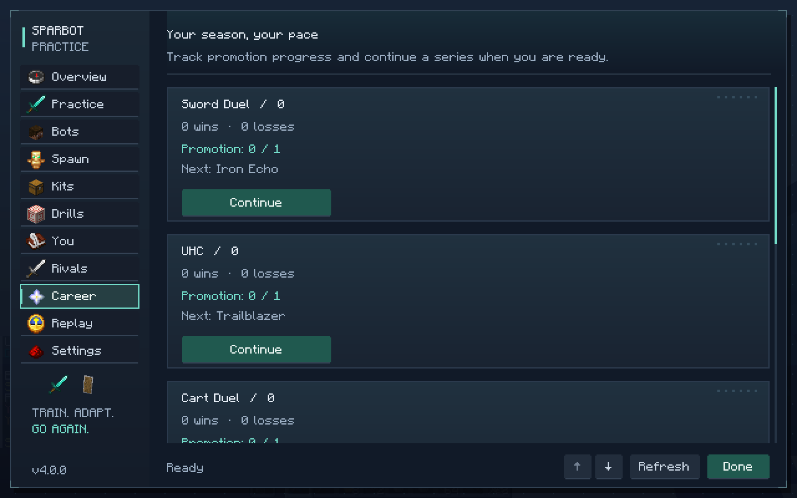
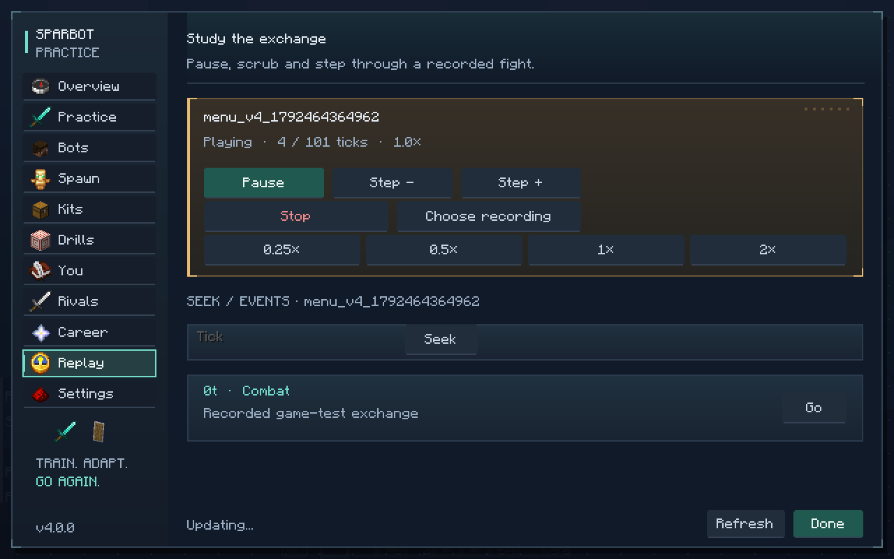

# SparBot 4.0.0

**[Download sparbot-4.0.0.jar](https://raw.githubusercontent.com/flick256/minecraft-pvp-mod-that-is-super-cool/refs/heads/builds/sparbot-4.0.0/sparbot-4.0.0.jar)**

For Minecraft **26.2**, **Java 25**, Fabric Loader **0.19.3+**, and Fabric API **0.161.0+26.2+**. Replace the older SparBot jar in your `mods` folder; keep Fabric API installed. Open the game menu with **B** or `/sparbot menu`.

4.0 adds:

- 18 named rivals across sword, UHC, cart, crystal and mace careers, with first-to-three promotion matches. Swight is the UHC champion.
- Optional practice difficulty adaptation between fights, a coaching journal and a recommended next drill.
- A native kit editor for cloning custom kits, equipment, stack counts and enchantments.
- Flat, uneven and obstacle practice terrain, safe round resets and rematches.
- Replay pause/resume, speed, tick seek, frame steps and observed combat/shield events. Existing recordings remain readable.
- Swight web conservation, interrupted wall-plan recovery, safer inventory backups and explosive cleanup between rounds.

[Read the illustrated guide](https://github.com/flick256/minecraft-pvp-mod-that-is-super-cool/blob/codex/rivals-4.0/docs/guide-4.0.md) · [Validation and upgrade notes](https://github.com/flick256/minecraft-pvp-mod-that-is-super-cool/blob/codex/rivals-4.0/docs/testing-4.0.md) · [Source](https://github.com/flick256/minecraft-pvp-mod-that-is-super-cool/tree/codex/rivals-4.0)

235 unit tests and 146 required Minecraft server tests passed, along with the real-client menu and two-world shutdown checks. The isolated eight-bot check averaged 8.53 ms per server tick on the cloud test machine. Lunar Client's launcher still needs a manual exit-recognition check.

`SHA256SUMS` contains the jar checksum. This branch holds downloadable build files; source code is on the linked source branch.

Built from source commit [`906d115d99c3`](https://github.com/flick256/minecraft-pvp-mod-that-is-super-cool/commit/906d115d99c34bc58b305256aeb092da392aac78).
