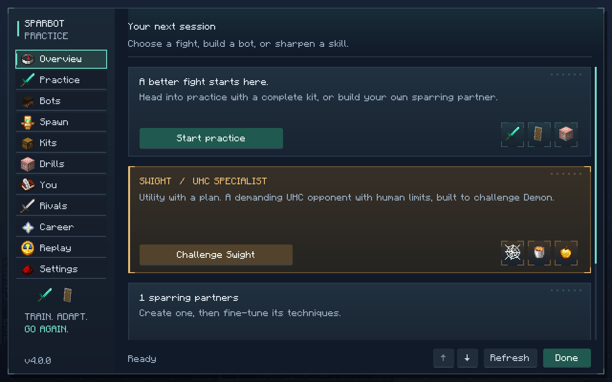
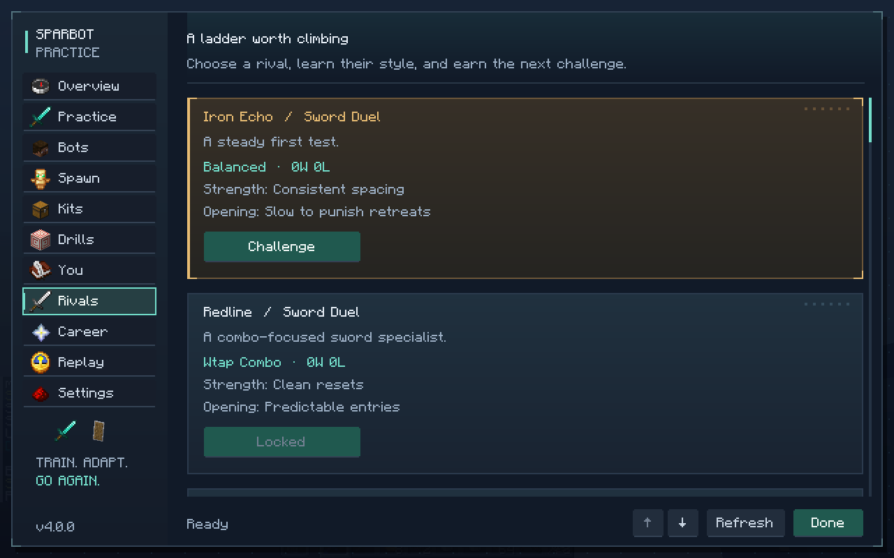
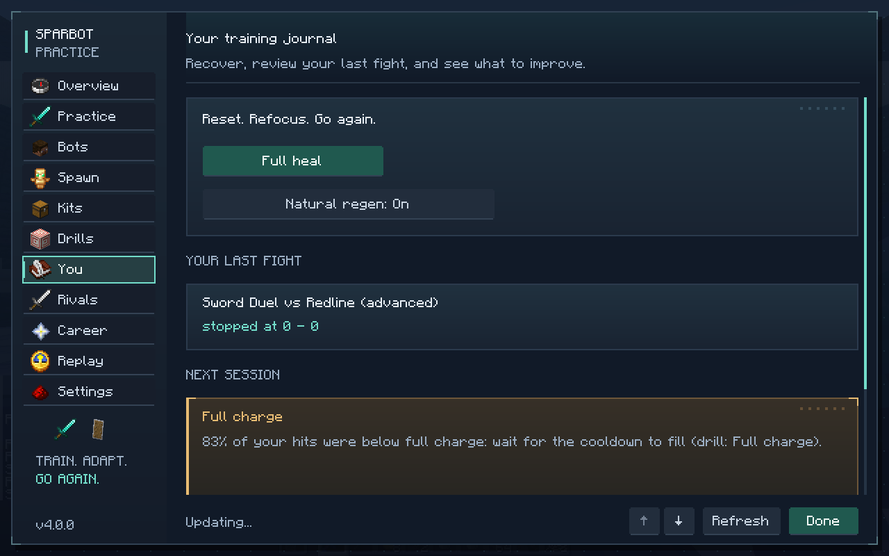
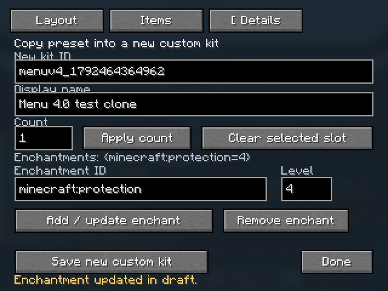

# SparBot 4.0 guide

SparBot 4.0 adds named rival challenges, career promotions, practice terrain, a draft-only kit editor and replay review controls. Open the menu with **B** or `/sparbot menu`; the guide below gives the command equivalents and explains what each feature saves.

## Rivals and careers

The 18 authored rivals form five circuits: sword, UHC, cart, crystal and mace. Every career match is first to three rounds (a best-of-five). Winning a promotion match advances that circuit and unlocks its next rival. The UHC circuit ends with Swight. Career progress is saved per player and discipline.

Use the **Rivals** tab to inspect opponents and challenge an unlocked rival. Use **Career** to check each circuit and continue its next promotion series.

```text
/sparbot rival iron_echo
/sparbot career
/sparbot career sword_duel
/sparbot career sword_duel continue
```

Practice adaptation is optional. When enabled, the profile for ordinary practice opponents can move one step easier or harder after a two-result streak. It takes effect between fights; it does not change an active match or a career rival.

```text
/sparbot career adapt on
/sparbot career adapt off
```

## Practice terrain and rematches

Choose **Flat**, **Uneven** or **Obstacles** in the Practice tab, or use the command. A rematch repeats the last practice opponent, mode and style on the currently selected terrain.

```text
/sparbot practice terrain uneven
/sparbot practice rematch
```

The terrain selection applies to practice fights and named rival challenges. Career rounds retain the circuit's authored opponent and first-to-three match rules.

## Kit editor

In **Kits**, choose **Edit** on a registered kit to open it as a draft. The editor has three tabs:

- **Layout** selects an inventory slot or equipment slot.
- **Items** searches registered items and places the chosen item in that slot.
- **Details** changes the new kit ID and display name, stack count, and enchantments.

The editor keeps item components when adjusting an existing stack, and saves the draft as a new custom kit with user-supplied, unverified provenance. Saving does not replace the registered source kit. The compact Details page keeps its save action available on smaller windows.

```text
/sparbot kiteditor sparbot_sword
```

Omit the kit ID to start from `sparbot_sword`. The Kits tab's **Edit** action opens its selected template directly.

## Replay and event review

The **Replay** tab lists saved recordings and running replays. Select a saved recording and choose **Play** to start it. While active, you can pause or resume, change speed, seek to a tick, step one frame in either direction, and jump to a selected event. Stop ends the replay.

```text
/sparbot record start scrim @s
/sparbot record stop scrim
/sparbot replay scrim
/sparbot replay pause scrim
/sparbot replay speed scrim 0.5
/sparbot replay seek scrim 120
/sparbot replay step scrim
/sparbot replay step scrim back
/sparbot replay stop scrim
```

Supported replay speeds are `0.25`, `0.5`, `1` and `2`. Event kinds can be shown or hidden while reviewing:

```text
/sparbot replay event scrim shield_check off
/sparbot replay event scrim shield_check on
```

New recordings use format version 2 and include timestamped review events such as incoming damage attempts, observed shield calculations, damage and defeats. Shield entries report what the game observed, including whether a shield was raised or in cooldown, the attacker angle and the calculation's damage reduction. Existing version 1 recordings remain readable. Recording ordinary matches automatically remains controlled by the `recordMatches` setting; authored rival and career matches request a recording for review.

## Coaching and the training journal

The **You** tab keeps recent fight reports and coach observations together. When an observation has enough attempts to support it and cites a named drill, the journal recommends one next drill with the reason and a **Start drill** action. Sparse evidence does not produce invented measurements or a drill recommendation. The tab also offers a rematch and shows the recent full-charge trend when reports contain it.

Drills can also be listed and started from commands:

```text
/sparbot drill
/sparbot drill <drill-id>
/sparbot drill stop
```

## Screens









