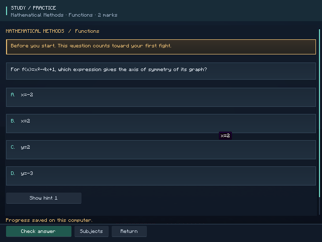
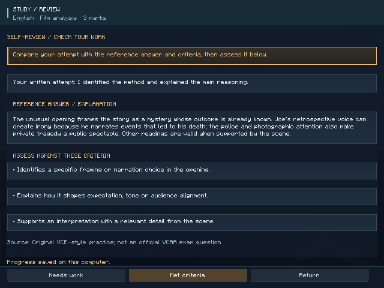
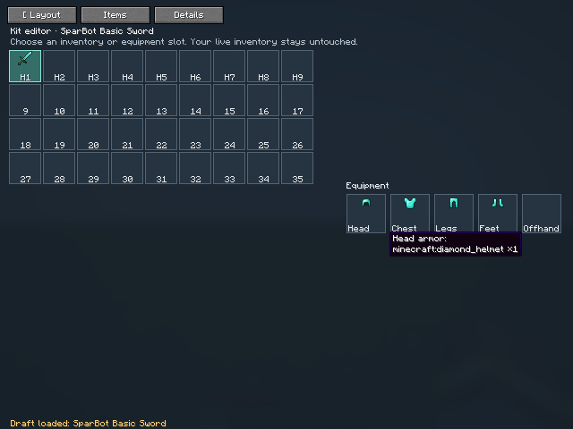
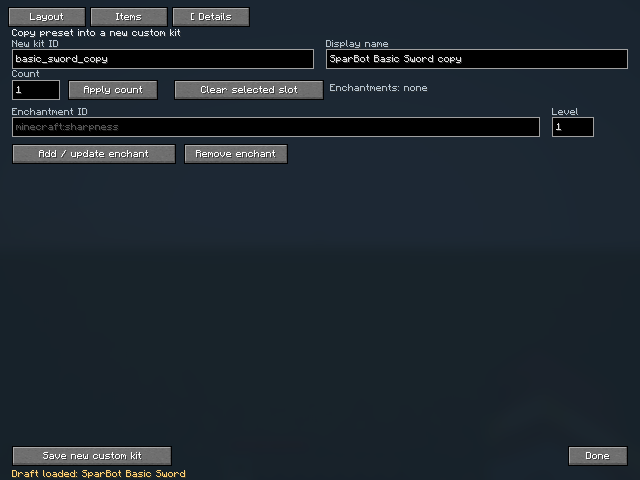
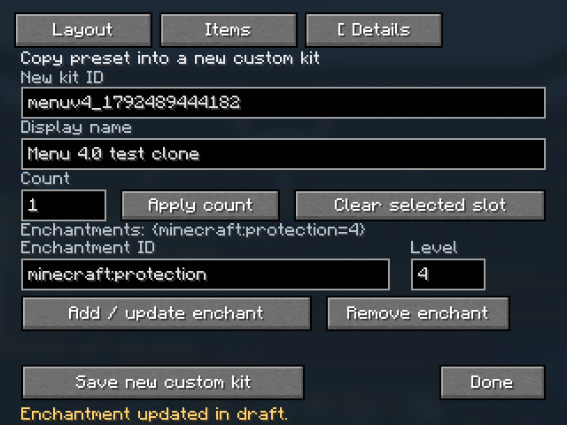

# SparBot 4.1 study guide

SparBot 4.1 adds a personal study routine for VCE Units 3/4 alongside the existing PvP practice features. All 72 questions are original VCE-style practice questions. They provide short warm-ups alongside your course materials, rather than a complete official VCE question bank.

## Subjects and question bank

The bank contains 12 English questions, 16 Mathematical Methods questions, 16 Chemistry questions, 12 French questions and 16 History Revolutions questions. English practice covers *Sunset Boulevard*, protest text creation and argument analysis using original passages. French and History Revolutions questions are included as warm-up practice, with History covering the French and Russian revolutions. The questions are authored for practice and should not be treated as an official exam or complete topic checklist.

## Study routine and progress

Study is enabled by default. A question opens once after joining a world, and completing it counts toward your first fight. Starting each later SparBot fight or drill opens another question; the requested activity starts only after you finish the feedback and press **Continue**. A multi-round match counts as one activity. From the home screen, **Open study** provides optional extra practice and one credit toward your next fight. Credits do not accumulate. Cancel discards a queued fight; you can always leave the world.

Questions support staged hints and feedback. Written responses use a self-review rubric; they are not automatically graded by AI. Marking a written response **Needs work** still records completion, but does not count as mastery, and the question becomes due again in 10 minutes. Unaided study intervals grow through 1, 2, 4 and 7 days. Hints or assistance can support learning, while unaided responses drive the spaced review schedule.

The study calendar starts with these exam dates and local Melbourne times for 2026. Subjects and dates can be edited from the study UI.

| Subject | Exam date and time (Melbourne, 2026) |
|---|---|
| English | 27 October, 09:00–12:15 |
| Mathematical Methods | 5 November, 09:00–10:15; 6 November, 11:45–14:00 |
| History Revolutions | 9 November, 15:00–17:15 |
| Chemistry | 10 November, 09:00–11:45 |
| French | 17 November, 15:00–17:15 |

## Offline settings and game behaviour

Study settings are stored locally in `config/sparbot/study.json`. The study bank and schedule work offline; you can adjust the subjects and exam dates in the UI without an online account.

Small revision tips appear on actual Minecraft level-loading screens without adding a delay. The question opens in its own study screen after joining. In singleplayer, this screen pauses the integrated server; on a multiplayer server, the game continues while the study UI is open. The routine applies to SparBot activities started by this client, rather than every ordinary Minecraft combat encounter.

## Menu fixes

Compact windows keep every navigation destination visible. Narrow kit cards put their actions in two rows, and the footer reserves room for scrolling and refresh controls. Home cards grow with wrapped descriptions. The kit editor fixes slot borders that stretched across the screen, reserves space between the inventory and equipment, and hides tiny slot captions when they would collide with item icons; hovering or focusing a slot still identifies it.

## Screenshots

See [4.1 validation](testing-4.1.md) for the automated checks and upgrade note.
