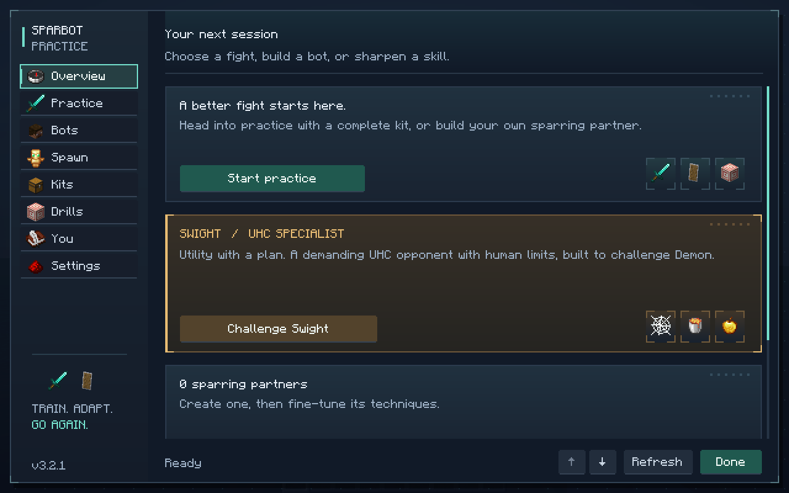
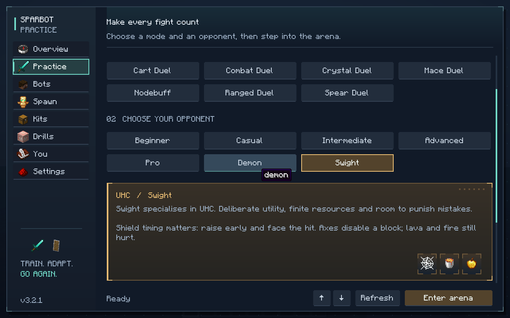

# 3.2.1: shield follow-ups, Swight web handling and menu decoration

Swight now changes aim toward an exposed part of a webbed opponent rather than repeatedly aiming
at an obstructing web. If the current attack line is still blocked, it sidesteps for an angle while
staying out of its trap. The choice uses already observed webs and the delayed opponent hitbox;
normal aim smoothing, jitter, reach checks, inventory limits and finite resources still apply.

An axe follow-up waits until the decision view has caught up with the axe click. A failed follow-up
skill roll no longer opens a forced double-click window. Swight also uses its normal hotbar switch
timing during the follow-up, including when it has planned the sequence. During axe confirmation
and the follow-up it keeps a useful aiming distance, rather than running into or past the opponent.

The menu keeps its navigation and forms, with native item icons, loadout illustrations, subtle
background dots, panel gradients and corner details. Decorative illustrations hide at compact
widths. The Swight practice card also explains shield timing and adapts its height to wrapped text.

## Shield behavior

New tests use a vanilla `ServerPlayer` defender and Swight's client emulator. They verify that:

- A ready shield facing Swight blocks its sword hit completely.
- The axe hit that disables that shield also deals zero health damage.
- A shield takes five ticks to become effective; a hit during that delay can hurt.
- A ready shield does not protect the defender's back.

The existing same-tick, next-tick and four-tick stun follow-up tests also pass. The `shieldStuns`
setting allows the subsequent hit after an axe disable to have its own knockback; it does not make
the disabling hit bypass an active block. Fire and lava damage are separate from a melee block.

## Validation

- 216 core unit tests and one connection cleanup test passed.
- All 137 required Minecraft server GameTests passed.
- All six shield GameTests passed.
- Both Swight GameTests passed, including a real hit below a head-height web that remains
  in place throughout the check.

- The real-client menu test passed, including navigation, actions, search, saved settings drafts,
  keyboard focus, compact layouts, and a clean client shutdown.





The cart-defence test stages its cart before unpausing the bot. Previously the bot could leave the
fixed drop location during the setup delay, so the test stopped exercising a cart beside it.

## Simulator regression check

A 200-fight PvPHQ UHC comparison against Demon used seed `481`, alternating sides, flat terrain,
identical kits and a 5,000-tick limit. Swight won **123**, Demon won **68**, and **9** timed out.
That is 64% of completed fights, or 62% of all starts. This is a simulator regression check, not a
measured win rate against human players or a fresh independent holdout.

```sh
./gradlew :sparbot-core:uhcLab -Pfights=200 -Pa=swight -Pb=demon -Pkit=pvphq_uhc -Pterrain=false -PmaxTicks=5000 -Pseed=481
./gradlew build
./gradlew runClientGameTest -PmenuOnly
```

Cloud checks used Java 25, Xvfb and software OpenGL. Gradle used the existing offline Loom metadata
configuration outside the checkout, with official cached metadata and unchanged artifact checksums.

Build, shield, Swight, stun-spacing and simulator logs are retained locally in
`build/reports/3.2.1-validation/` (generated files excluded from Git).
